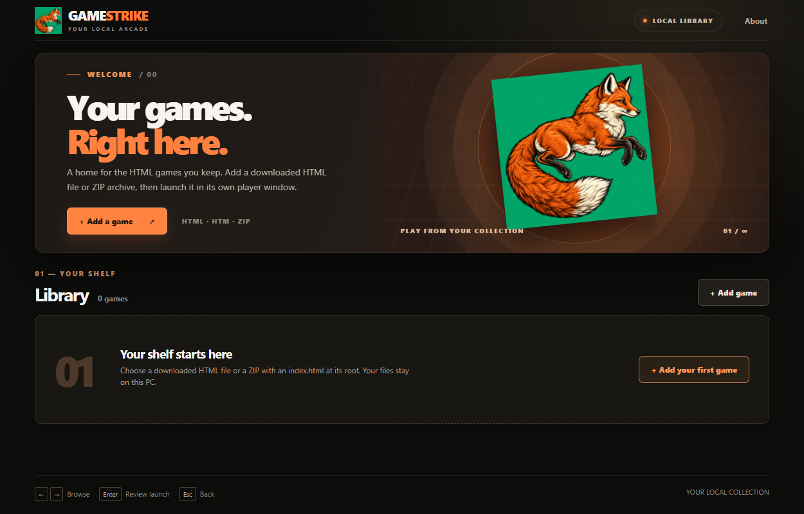
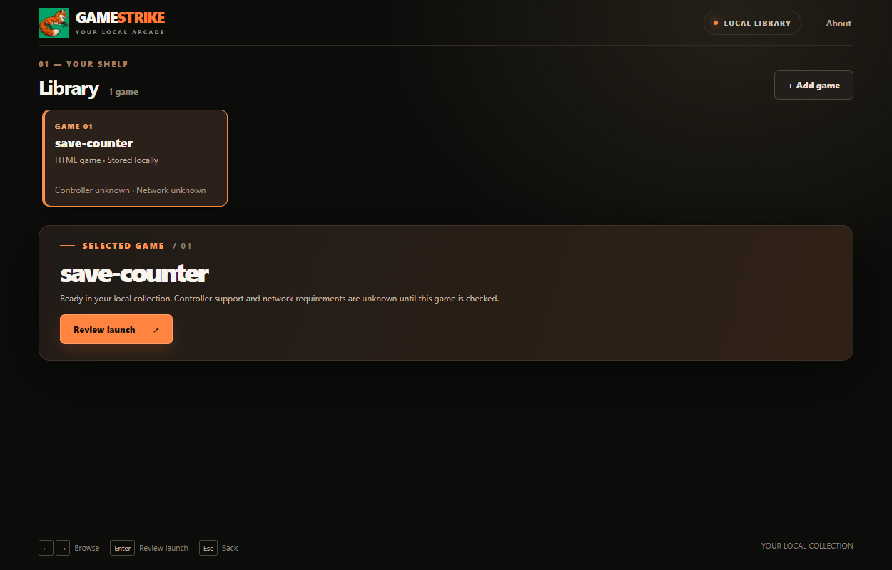

<p align="center">
  
</p>

<h1 align="center">GameStrike</h1>

<p align="center">
  <a href="https://prowebdevsolutions.com"><picture>
    <source media="(prefers-color-scheme: dark)" srcset="assets/branding/PWDS-logo-orange.svg">
    
  </picture></a>
</p>

**A local home for HTML games you choose to keep.** GameStrike has a Windows library launcher, a bounded HTML/ZIP importer, and a separate player for each selected title. Your game files stay on this PC. The screenshots below come from the running Windows launcher.

[Actual screenshots](#actual-windows-captures) · [How it works](#how-it-works) · [Build and run](#build-and-run) · [Player security](docs/PLAYER_SECURITY.md) · [Original artwork](assets/branding)

## Actual Windows captures

These are PNGs captured from the rendered WebView2 window of the [CI-built Windows launcher](https://github.com/Gerbzz/GameStrike/actions/runs/38650007764) on the Office PC. The populated library contains only the bundled benign `save-counter.html` fixture, imported into an isolated test library. The images have not been composited or retouched.

**Your empty library, 1250 × 800**



**A local game in the library, 1250 × 800**



The [880 × 620 minimum-window capture](docs/screenshots/local-library-minimum.png) shows the same shelf, selected-game panel, and controls fitting above the footer. [Capture provenance](docs/screenshots/README.md) records the exact source commit and method.

## How it works

1. Open the **GameStrike library**. It starts with a welcome view until you import a game, then puts your actual local collection first. Title-led cards show source format and unknown controller/network status without inventing cover art.
2. Choose **Add game** and select a `.html`, `.htm`, or `.zip` file from the Windows file picker. A ZIP needs `index.html` at its root. The library copies and validates the source; it does not run install scripts or upload the file.
3. Choose a card to review the launch warning. **Allow network & launch** opens that game's generated ID in the separate `gamestrike-player.exe` process. The library reports a missing player or a player exit instead of pretending launch succeeded.

Arrow keys, Enter, and Escape navigate the library. The launcher also polls a connected controller for D-pad/left-stick navigation, A to activate the focused choice, and B to back out of the launch dialog. The launch dialog starts on **Go back**; moving right focuses **Allow network & launch** before a fresh A can approve it. Those controls apply to the library only; each imported game's own controller support is **unknown**.

The original GameStrike fox anchors the library. Its About panel carries the official PWDS publisher logo, keeping the working view focused on GameStrike. The UI uses only generated manifest titles rendered as text, without importing game HTML into its trusted window.

## Import and player foundation

### Bounded import

Import one HTML file or a ZIP with a root `index.html`. GameStrike copies bounded content into `LIBRARY/games/<id>/content`, assigns an ID, and writes its own `game.json`. It rejects traversal, absolute and device paths, links and special files, case-insensitive duplicates, unsupported compression, and archives that exceed its size or entry limits. Formats with a nested or nonstandard entry point are not supported yet.

### Separate browser data

The Windows player opens one imported ID at a time. Each game gets its own UUID-derived HTTPS-mapped origin and persistent WebView profile under `LIBRARY/profiles/<id>`. A first-party save fixture reopened with its state intact, while a second ID used separate storage. A separate process is an application boundary, **not an OS sandbox**.

### Trusted library window

The launcher serves only bundled HTML, CSS, JavaScript, fox artwork, and PWDS artwork from its own fixed origin. Its IPC commands are limited to reading the library, choosing a local import file, and launching a validated game ID. Imported game HTML runs only in the separate Wry player, which has no launcher IPC handler. The launch dialog discloses that game content may contact local or remote services. Controller and network requirements stay **unknown** until a game is checked.

## Build and run

On Windows, use Rust with edition 2024 support and the WebView2 runtime. Build both executable files into the same Cargo output directory:

```powershell
cargo build --locked --offline --features launcher-windows --bin gamestrike-launcher --bin gamestrike-player
./target/debug/gamestrike-launcher.exe
```

By default, the library lives at `%LOCALAPPDATA%\GameStrike\Library`. For a portable test library, pass `--library DIRECTORY` to the launcher. Keep the launcher and player executables side by side. Check local disk headroom before a Windows build.

The CLI remains available for import and inspection:

```text
gamestrike --library LIBRARY import GAME.html
gamestrike --library LIBRARY import GAME.zip
gamestrike --library LIBRARY list
gamestrike-player --library LIBRARY --id GAME_UUID --allow-network
```

**Strict offline play is unavailable.** Game JavaScript may still contact local or remote services, and some titles need remote assets to work. Do not treat arbitrary downloaded games as safe under this checkpoint; use only controlled fixtures until the [browser boundary checks](docs/PLAYER_SECURITY.md) are complete. No third-party games or assets are bundled.

## Current status

The launcher provides an empty shelf, real title-led game cards, importing and rejected-import states, network consent, keyboard/controller navigation, and player start/exit feedback. [Windows source checks](https://github.com/Gerbzz/GameStrike/actions/runs/38650007764) built both binaries and passed 8 importer tests, 1 launcher origin test, 5 player tests, 5 input regressions, formatting, and JavaScript syntax. The actual library was captured and inspected at normal and minimum sizes; the player ran the controlled fixture at standard Windows integrity (`GameStrike fixture launch 1`, exit 0). The native file picker and player round trip through the launcher still need hands-on checks. Controlled browser-boundary tests remain before general-game safety claims.

The separate Wry/system-WebView player is designed to have no Tauri commands, launcher credentials, game-to-host message bridge, or unrestricted file access. It limits local assets to the selected game's content root and registers navigation, download, window, and permission restrictions. Those checks still need controlled runtime validation across frames, protocols, workers, and network paths. Read [PLAYER_SECURITY.md](docs/PLAYER_SECURITY.md) before widening use; [LAUNCHER_UI.md](docs/LAUNCHER_UI.md) records the launcher implementation.

Native app-icon and packaging work remain. The next verification is to exercise file picker cancellation, benign import and rejected archive through the launcher, keyboard/controller focus, player return, and browser-boundary fixtures.

Explore the other [PWDS Strike repositories](https://github.com/Gerbzz?tab=repositories&q=Strike).

## PWDS brand artwork

The company mark in this masthead is the existing [official PWDS logo](https://github.com/Gerbzz/PWDS-Website/blob/main/public/prowebdevsolutions-logo.png), with the [official orange display asset](https://prowebdevsolutions.com/images/prowebdevsolutions-logo-orange.svg) for dark backgrounds. The GameStrike fox is original Strike suite artwork. Existing artwork files and their provenance are preserved.
