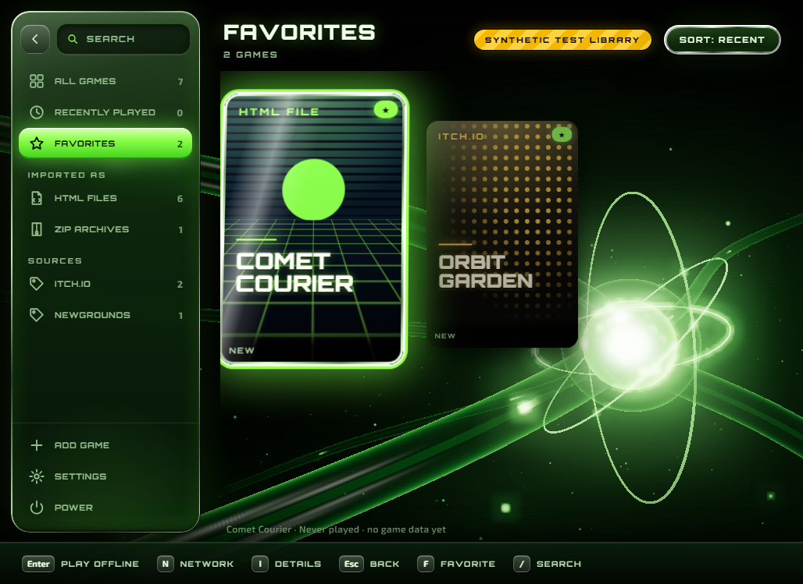
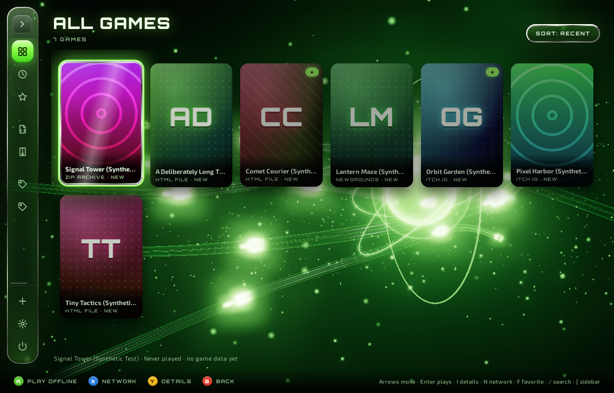

<p align="center">
  
</p>

<h1 align="center">GameStrike</h1>

<p align="center"><strong>A console-style home for the HTML games you download, on Windows, Linux, and macOS.</strong><br>
Add a game from an <code>.html</code> file or a <code>.zip</code>, pick it from a 3D, console-style library with a mouse, keyboard, or controller, and play it in its own window. Offline by default, with saves kept per game. No account, no uploads.</p>

<p align="center">
  <a href="#what-works-today">What works</a> ·
  <a href="#screenshots">Screenshots</a> ·
  <a href="#platforms">Platforms</a> ·
  <a href="#build-and-run">Build and run</a> ·
  <a href="#how-games-are-isolated">Isolation</a> ·
  <a href="#verification">Verification</a> ·
  <a href="#limitations">Limitations</a> ·
  <a href="#credits-and-license">Credits</a>
</p>


> [!IMPORTANT]
> **Early, unreleased software.** There is no installer or signed binary yet; you build it from source. Imported games are untrusted code. Offline mode blocks their network traffic, but the player is **not** an operating-system sandbox. Read [Limitations](#limitations) before running games you don't trust.

## What works today

Everything in this section is implemented in this repository and covered by the checks listed under [Verification](#verification).

**Library**
- Add a game through the native file picker: a single `.html`/`.htm` file, or a `.zip` with `index.html` at its root or inside one wrapper folder. GameStrike copies the files into its own library; your original download is never modified.
- Re-adding the exact same file is recognized, and the game keeps its saves.
- Browse a **3D console-style library**, an original homage to the 2001 console dashboard crossed with a cover-grid game launcher:
  - A real-time WebGL scene behind everything (bundled three.js): a dark green void, a pulsing core with orbiting rings, translucent energy conduits with travelling pulses, drifting wisps, and bloom. The camera flies between the library, a game's details, saves, settings, and About, and the interface moves with it in 3D.
  - A green-glass sidebar with chrome rims: search, then filters built from your library (*All games*, *Recently played*, *Favorites*, *HTML files* and *ZIP archives*, and each source you note, such as *itch.io*), with *Add game*, *Settings*, and *Power* at the bottom. It collapses to icons.
  - A dense grid of portrait covers that reflows from 880 × 620 to fullscreen. The focused cover lifts toward the camera with a chrome and green-glow rim and a light sweep; its neighbours recede.
  - Wide techno headings (Orbitron) and a clean text face (Exo 2), both bundled under the SIL Open Font License.
  - A startup sequence with the GameStrike mark in front of the core, skippable with any key, click, or button.
- **Covers.** A game with no art gets generated box art: a curated palette, a geometric motif, and its full title in the display face. An image in the game's own files (for example `icon.png` or `thumbnail.png`) becomes its cover automatically, and you can set your own from a local image, then undo or reset it. Every cover image is untrusted: it is decoded by memory-safe Rust code with size limits and re-encoded as a new PNG inside the library.
- **Favorites and sources.** Mark favorites, and note where a game came from (1 to 32 characters); both become sidebar filters.
- Search by title, and sort by recently played, title, or date added.
- A **detail panel** for each game: when it was added, last played, how often, how much data it has stored, and its cover kind, with play, favorite, cover, source, rename, clear saves, and remove. A removal can keep the saves, so adding the same file again brings them back.
- Problems are reported rather than hidden. One unreadable folder doesn't hide the rest of the library, and a game whose files have disappeared shows *Files missing* and won't launch.

**Playing**
- **Play offline** (the default) opens the game in a separate `gamestrike-player` window. The game's network requests are blocked. When the game closes, the launcher says how many requests the game itself attempted, so you can decide whether it needs network access.
- **Play with network…** asks for consent first; focus starts on *Go back*.
- Each game has its own browser origin and profile, so `localStorage`, IndexedDB, and cookies persist across launches and never mix between games.
- Only one game runs at a time. While it runs, the launcher shows *Playing*, pauses its 3D scene, and the game can't be removed or cleared.

**Input**
- Mouse, keyboard (arrows, Enter, `I` details, `N` network, `F` favorite, `F2`, `Delete`, `/` or `Ctrl+F` search, `[` sidebar, `M` mute, `Esc`), and a standard-mapping controller: D-pad or stick to move through the grid and sidebar, **A** to play or select, **X** for network, **Y** for details, **B** to go back. A held button never repeats, so it can't confirm a dialog that opens underneath it. Every control has a visible focus ring and a screen-reader label.
- Original interface sounds (move, select, open, back, launch, error), synthesized at run time from oscillators and filtered noise; no samples. Mute them with `M` or in *Settings*.
- Reduced motion turns the 3D scene into still frames with no camera moves and makes every transition instant. High-contrast (forced colors) is respected.
- Without WebGL 2, or if the GPU context is lost, a static painting of the scene is drawn instead and the interface works the same.

**Command line** (`gamestrike`): `import`, `list`, `rename`, `reset-saves`, `remove [--keep-saves]`, `set-source`, `favorite`, `set-cover`, `undo-cover`, and `reset-cover`.

## Screenshots

Every launcher image below was rendered by the real `gamestrike-launcher` in GitHub Actions ([Cross-platform checks run 39258622798](https://github.com/Gerbzz/GameStrike/actions/runs/39258622798)) through the `--capture-preview` option: WebView2 on Windows, WebKitGTK under Xvfb on Linux, and WKWebView on macOS. Each capture's log reports that WebGL drew the backdrop at the "high" quality step on all three systems. Captures put the camera at its station and render still frames, so the light sweep and camera flights are not shown. Frame rates were not measured; CI runners are virtual machines, and the macOS runner's screen crops its captures to 1024 × 645. Every game shown is a labeled **synthetic test fixture** with a generated cover; no third-party game or art appears. They are not mockups.

| | |
| --- | --- |
|  **Focused cover** (Windows), lifted with a chrome and glow rim. |  **Game details** (Linux). The camera and library turn as the panel flies in. |
|  **Startup** (Linux), near its end. |  **Network consent** (macOS). Offline is the default. |
|  **Favorites** filter (Windows). |  **Collapsed sidebar** (Linux). |
|  **Search** (macOS). |  **About** (Linux), with the publisher credit. |
|  **First launch** (Windows). |  **Minimum window size**, 880 × 620 (Linux). |
|  **A game in its own offline player window** (Windows, from the manual run at `c888e7e`; the player is unchanged). | |

Screenshots of earlier designs are kept in [docs/history](docs/history).

## Platforms

Only platforms that GitHub Actions has built **and** tested, including the real player isolation test, count as supported. See [docs/PLAYER_SECURITY.md](docs/PLAYER_SECURITY.md#per-platform-implementation) for how each guarantee is implemented per OS.

| Platform | Engine | Status | Evidence |
| --- | --- | --- | --- |
| Windows (CI: `windows-latest`, Windows Server 2025 image) | WebView2 | **Supported** | [CI run 39261168566, windows job](https://github.com/Gerbzz/GameStrike/actions/runs/39261168566/job/118088878425): fmt, clippy, Rust and JS tests, real-player isolation test, release build, player smoke test, launcher captures |
| Linux x64 (CI: `ubuntu-latest`, Ubuntu 24.04) | WebKitGTK 4.1 (2.52.6 in CI) | **Supported** | [same run, ubuntu job](https://github.com/Gerbzz/GameStrike/actions/runs/39261168566/job/118088878299): the same steps, with the player and launcher windows under Xvfb |
| macOS 14 or later (CI: `macos-latest`, macOS 26.6 on Apple silicon; 14 and 15 not tested) | WKWebView | **Supported** | [same run, macOS job](https://github.com/Gerbzz/GameStrike/actions/runs/39261168566/job/118088877675): the same steps |

Platform caveats that apply even when a platform is verified:
- **Linux and macOS:** WebRTC is switched off for games in both offline and network mode, because WebKit offers no way to limit its UDP to the proxy. Games that need WebRTC will not work there.
- **macOS:** turning WebRTC off uses WebKit's private peer-connection preference; if a future macOS removes it, the player refuses to start rather than run without it. Each game's saves live in a WebKit data store named after the game ID (outside the library folder), so the library's "game data" size shows 0, and copying a library folder to another Mac does not copy its saves. Needs macOS 14 for per-game data stores; older versions are refused.
- **macOS:** Clear saves deletes every website data type from the game's data store through WebKit's public API; the empty store folder stays. Launcher captures in CI come out at the runner's screen size (1024 × 645), not the requested 1250 × 800.
- **Windows:** in 3 of about 10 Windows CI runs on this branch, the second offline launch of a game failed its first same-origin `fetch()` (blocked by the offline proxy, so nothing leaked). The probe now retries that fetch and logs the attempts; games that fetch their own files may see the same occasional failure. The cause is not yet known.
- **Windows:** WebView2's helper processes can hold a game's profile files open for a moment after the player exits. Clearing saves or removing a game right after closing it retries the delete for up to five seconds (CI hit this twice before the retry was added).
- **All platforms:** the player is not an OS sandbox (no AppContainer, bubblewrap, or App Sandbox). Saves are kept in the engine's own format, so they do not move between operating systems.

## Build and run

Stable Rust with edition 2024 support, plus:

| OS | Prerequisites |
| --- | --- |
| Windows 10/11 | The [WebView2 runtime](https://developer.microsoft.com/microsoft-edge/webview2/) (preinstalled on Windows 11) and the MSVC build tools. |
| Linux | WebKitGTK 4.1 and GTK 3 development packages. Debian/Ubuntu: `sudo apt install libwebkit2gtk-4.1-dev libgtk-3-dev libsoup-3.0-dev libjavascriptcoregtk-4.1-dev`. Fedora: `webkit2gtk4.1-devel gtk3-devel libsoup3-devel`. |
| macOS 14+ | Xcode Command Line Tools (`xcode-select --install`). |

```sh
cargo build --locked --release --features launcher --bins
./target/release/gamestrike-launcher        # .\target\release\gamestrike-launcher.exe on Windows
```

The `launcher-windows` / `player-windows` feature names from earlier versions still work; `launcher-linux` and `launcher-macos` are aliases too. The launcher expects `gamestrike-player` in the same folder, which this build produces. Pass `--library DIRECTORY` to use another folder, for example a throwaway test library. Default library locations:

| OS | Default library |
| --- | --- |
| Windows | `%LOCALAPPDATA%\GameStrike\Library` (unchanged, so existing libraries and saves keep working) |
| Linux | `$XDG_DATA_HOME/gamestrike/library`, usually `~/.local/share/gamestrike/library` |
| macOS | `~/Library/Application Support/GameStrike/Library` (saves: WebKit data stores, see above) |

```text
gamestrike --library DIR import GAME.html|GAME.zip
gamestrike --library DIR list
gamestrike --library DIR rename GAME_UUID "New title"
gamestrike --library DIR reset-saves GAME_UUID
gamestrike --library DIR remove GAME_UUID [--keep-saves]
gamestrike-player --library DIR --id GAME_UUID --offline|--allow-network
```

**Tests**

```sh
cargo fmt --all -- --check
cargo clippy --locked --features launcher --all-targets -- -D warnings
cargo test --locked --features launcher
node --test ui/app.test.cjs
# Opens real player windows for about 30 seconds (prefix with `xvfb-run -a` on headless Linux):
cargo test --locked --features launcher --test player_isolation -- --ignored --nocapture
# Release launch and capture smoke test with synthetic games (Linux/macOS; Windows: scripts/hosted-library-capture.ps1):
bash scripts/hosted-library-capture.sh target/release /tmp/gamestrike-capture
```

## How games are isolated

| Layer | What it does |
| --- | --- |
| Separate process | Game HTML runs only in `gamestrike-player`, never in the launcher's WebView. The player registers no IPC handler or host objects, and disables WebView2 web messages and host objects before loading the game. A source test fails if any of that is added. |
| Per-game origin and profile | Each game is served from `https://gamestrike<uuid>.localhost` with its own WebView2 data folder. |
| Files | Only canonical files inside that game's content folder are served. `file://` fetches, frames, and navigation are blocked, as are other origins, popups, downloads, permission prompts, and external protocol launches. |
| Offline mode | A strict Content-Security-Policy (only the game's own origin plus `data:`/`blob:`) on every response, plus a proxy owned by the player that answers every HTTP, HTTPS, and WebSocket connection with 403, including loopback. WebRTC is restricted to proxied traffic, which blocks its UDP. |
| Network mode | Only plugins and base-URL changes are restricted. The game can reach the network, and you are told so first. |
| Launcher | Serves only its bundled files (UI, the vendored three.js, fonts) under `default-src 'none'`, plus cover PNGs that GameStrike encoded, by game ID only. It accepts eleven JSON commands, and only from its own origin. The page never supplies a file path; Rust validates every game ID. The 3D scene is decoration and never receives game content. |
| Covers | Untrusted cover images are decoded only by the memory-safe Rust `image` crate (PNG, JPEG, GIF, WebP; 16 MiB per file, 8192 px per side, 256 MiB of decoder memory), scaled to fit 600 × 900, and re-encoded as a new PNG inside the library. SVG and HTML are refused. |
| Imports | Rejects path traversal (zip-slip), absolute and drive paths, Windows device names, links and special files, case-insensitive duplicates, ambiguous entry points, unsupported compression, zip bombs (expansion ratio and size limits), and corrupt archives. Extraction is staged and published atomically. |
| Integrity | The player refuses to open imported games from an elevated (high-integrity) process. |

The details and remaining open questions are in [docs/PLAYER_SECURITY.md](docs/PLAYER_SECURITY.md). The launcher's IPC and input model is in [docs/LAUNCHER_UI.md](docs/LAUNCHER_UI.md).

## Verification

Linux and macOS results come from CI only; see [Platforms](#platforms) and the per-OS tables in [docs/PLAYER_SECURITY.md](docs/PLAYER_SECURITY.md#linux-and-macos-measurements). The rest of this section is the Windows record.

Results as of 2026-10-17 on Windows 11 Pro, WebView2 runtime as installed on the dev PC and on GitHub's `windows-latest` runner.

**Automated, all passing in [cross-platform CI](https://github.com/Gerbzz/GameStrike/actions/workflows/cross-platform.yml) on Windows, Linux, and macOS:**
- Rust: 36 library tests, 14 player tests (15 on Linux and macOS), 8 launcher tests, and 2 player command-line tests, plus the real-player isolation test. Besides the areas below, they cover cover decoding and its limits (including a forged 9000 × 9000 PNG header), custom, automatic, undone, and reset covers, sources and favorites, the cover endpoint, and that every bundled UI file is served and every module import resolves. They cover zip-slip, drive paths, device names, corrupt and empty files, expansion limits, duplicate and legacy re-imports, removal with and without saves, restoring kept saves, clearing saves, the per-game lock, rename validation, tolerant scanning, missing files, the launcher's origin and command allow-list, and CSP headers.
- JavaScript: 16 tests of sorting, search, the sidebar filters built from library data, the source rule, cover URLs, grid reflow and list movement, the earlier shelf and perspective helpers, controller edge detection and repeat, generated covers, and formatting.
- **Real player isolation test** (`tests/player_isolation.rs`). It runs the real WebView2 player against a bundled probe page, with a harness listening on loopback over TCP and UDP.
  - Offline, twice: 0 TCP and 0 UDP connections reached the harness. Fetch, XHR, WebSocket, image, `file://`, other-origin requests, and popups were all blocked.
  - Network mode, as a control: the same probe reached the harness (8 TCP connections, 4 UDP packets), which shows the offline zeros mean "blocked", not "unobservable".
  - Saves: `localStorage` and IndexedDB counters reached 3 across relaunches. A second game started at 1, so the profiles are separate.
  - A second player for a running game is refused.

**Manual run of the real app** (computer use, build at `c888e7e`, before the console-style restyle; the Rust side is unchanged since apart from `bc6fd31`):
- Native picker: cancel left the library unchanged; an HTML import was added and selected.
- Offline launch, then the player closed back to the launcher with an exit message.
- Relaunch: the save counter kept its `localStorage` points and IndexedDB count, and play count went to 2.
- While a game ran, the launcher showed *Playing* and disabled Play.
- A wrapped ZIP imported, and its relative CSS and JS loaded offline.
- A zip-slip archive ("ZIP contains an unsafe path") and a corrupt archive were rejected with a message, leaving the library unchanged.

That run found two issues, both fixed in `bc6fd31`: the offline summary counted WebView2's own background requests as the game's, and the corrupt-ZIP error was too technical.

**Not yet verified by hand:** the 3D library has been rendered and captured from the real launcher in CI on all three systems, and its keyboard flow was exercised in a browser preview with a stubbed IPC, but it has not been driven interactively in the real app. The manual run above used the earlier design. Rename, clear saves, remove, duplicate re-import, network launch, and a physical controller were checked only by automated tests.

## Limitations

- **Not a sandbox.** The player is an ordinary user-level process. Offline mode blocks network paths at the browser level (CSP plus proxy plus WebRTC policy). It does not stop a browser engine exploit, and the probe doesn't cover every possible network path, such as DNS prefetch.
- WebView2 still defines `window.chrome.webview` in game pages. GameStrike registers nothing behind it, but the object exists.
- In network mode, the runtime's own requests for the game's origin outside the custom protocol resolve to `localhost` and could reach a local server on port 443.
- Controller support and network needs are shown as *not checked* for every game; GameStrike does not inspect games.
- Generated box art is decoration (a palette, a motif, and the title, chosen from the game ID), not the game's own artwork.
- The 3D library was checked only through CI captures on virtual machines. It has not been run by hand on real hardware, and its frame rate on integrated GPUs has not been measured; the automatic quality steps are untested there. In one early CI run the Windows runner lost its WebGL context once, and the static fallback drew that capture.
- The interface panels are HTML and CSS 3D in front of the WebGL scene, not meshes inside it, so they glow with CSS shadows rather than the scene's bloom, and WebKit (Linux and macOS) does not blur the scene behind 3D-transformed panels.
- See [Platforms](#platforms) for which operating systems are verified. No installer, code signing, auto-update, or app icon resource yet.

## Credits and license

GameStrike is published by [PWDS (ProWebDevSolutions)](https://prowebdevsolutions.com). The geometric GameStrike mark is original artwork for this project. The PWDS logos in `assets/branding` are the official PWDS assets and are not covered by any open-source license. The *Blades* and *Original* styles are original recreations inspired by the look of the Xbox 360 and original Xbox dashboards. They use no Microsoft logos, artwork, sounds, or fonts, and GameStrike is not affiliated with or endorsed by Microsoft; Xbox is a trademark of Microsoft Corporation. The colored A/B/X/Y glyphs follow the common controller color convention and are drawn in CSS.

Built with [Wry](https://github.com/tauri-apps/wry) and [Tao](https://github.com/tauri-apps/tao) (Apache-2.0/MIT), [webview2-com](https://github.com/wravery/webview2-rs) (MIT), [zip](https://github.com/zip-rs/zip2) (MIT), and [serde](https://serde.rs) (Apache-2.0/MIT). The README layout takes cues from [PhotoCraft](https://github.com/storytold/photocraft): a status callout, features kept separate from limitations, and command-first build steps. No code or assets were copied from it.

No license file has been chosen for GameStrike's own code yet; until one is added, all rights are reserved by the author. Other [PWDS Strike apps](https://github.com/Gerbzz?tab=repositories&q=Strike) follow the same suite design.
