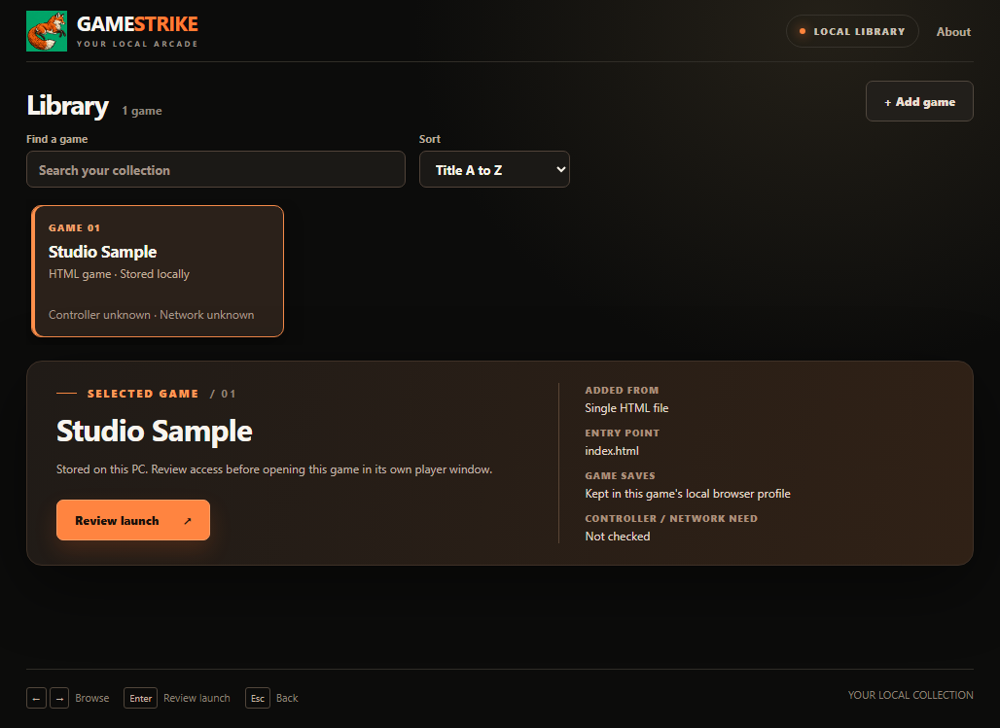

# Current launcher visual

This is an unaltered app-window PNG captured from the Windows launcher at source commit `ddc757fb86f32b7f204d4e50bb90338fbdf15214` in [hosted run 38988544660](https://github.com/Gerbzz/GameStrike/actions/runs/38988544660). The workflow imported a small local HTML fixture as **Studio Sample** and launched only `gamestrike-launcher.exe` with `--capture-preview`. The screenshot is 1028×749 pixels, with SHA-256 `460C95AF144C8535B9F59B2CFAFF76383EB9567735B8448E084E171657A03A89`.

The fixture verifies the local library layout, selected-game summary, primary launch review button, search, sort, and game card. It does not verify the standalone player window or a controller-driven interaction on screen.
